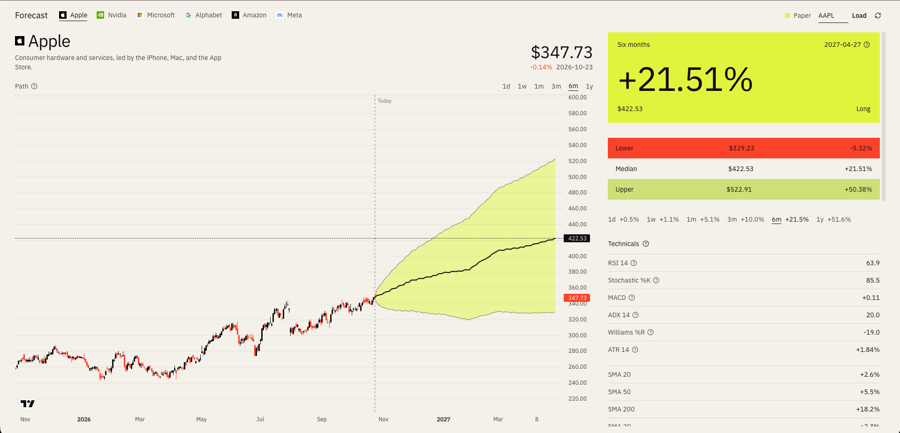

# TFT Finance

A local research desk for daily equity forecasts. One Temporal Fusion Transformer decodes the next 252 trading sessions. The desk reads the 1-day, 1-week, 1-month, 3-month, 6-month, and 1-year steps off that path, with a 10–90% price band, a long-or-flat call after costs, and a walk-forward report.

Checkpoints, scalers, and processed frames stay on disk. There is no database. This is a research tool, not a trading recommendation.



## Features

**Forecasts**

- One model per ticker, trained on daily prices from 2010 through the last completed session.
- A single 252-day decode. Horizons are 1 day, 1 week, 1 month, 3 months, 6 months, and 1 year.
- Quantile outputs at 0.1, 0.5, and 0.9. The chart draws the median path and a 10–90% band that widens with the square root of the horizon.
- A long signal only when the median simple return clears a 30 bp round trip (10 bp commission and 5 bp slippage each way). Otherwise the desk stays flat.
- Per-horizon cards for return, signal, and the edge left after costs.

**Desk**

- Candlestick history with the forecast path overlaid, and a horizon switch for 1 day through 1 year.
- Ticker load and refresh. Each symbol is its own checkpoint.
- Walk-forward table: directional accuracy, 10–90% coverage, Sharpe, and max drawdown, in-sample and out of sample, after costs.
- Encoder variable importance from the trained network, so you can see which inputs the model actually used.
- Training from the desk or from the command line. The API blocks until the run finishes.

**Model inputs**

Price-level studies are stored as a gap from that session’s close. Oscillators on a 0–100 or −100–0 scale are divided by 100. Every non-target input is then z-scored with a scaler fit on the training slice only.

| Study | Settings |
| --- | --- |
| SMA, EMA | 10, 20, 30, 50, 100, 200 |
| Ichimoku base line | 9, 26, 52, not shifted forward |
| VWMA, Hull moving average | 20, 9 |
| RSI | 14 |
| Stochastic %K and %D | 14, 3, 3 |
| CCI, ADX | 20, 14 |
| Awesome Oscillator | 5, 34 |
| Momentum | 10 |
| MACD and signal | 10, 12, 9 |
| Stochastic RSI | 3, 3, 14, 14 |
| Williams %R | 14 |
| Bull power, bear power | 13-session EMA |
| Ultimate Oscillator | 7, 14, 28 |
| ATR | 14, divided by close |
| Realized volatility | 5, 20, and 60 sessions |
| Return lags | 1, 5, and 21 sessions |
| Log volume | trailing, log1p |

Known future inputs are calendar only: day of week, month, quarter, earnings date, dividend date, and whether the session sits against an NYSE holiday. Earnings and dividend features are event dates. Reported EPS and dividend amounts are never read.

## Setup

Python 3.12 or 3.13. Newer system Pythons may not have a matching PyTorch wheel.

```bash
uv venv --python 3.12 .venv
source .venv/bin/activate
pip install -r backend/requirements.txt

cd frontend
npm install
```

## Train

From the repository root, with the virtualenv active:

```bash
python -m model.train --ticker AAPL
```

That writes:

- `backend/models/aapl/tft.ckpt`
- `backend/models/aapl/dataset.pt` (the training dataset, including scalers)
- `backend/models/aapl/evaluation.json`
- `backend/models/aapl/interpretability.json`

On an M4 Air a full run is often 30–90 minutes. Early stopping watches validation quantile loss. If MPS runs out of memory, training rebuilds the network and continues on CPU. Force the device with `--accelerator cpu`.

The same job can be started from the API. It blocks until training finishes:

```bash
curl -X POST http://localhost:8000/api/train \
  -H 'Content-Type: application/json' \
  -d '{"ticker":"AAPL"}'
```

Another ticker is a separate checkpoint. Train it, then load the symbol in the desk.

## Run

Two terminals. The virtualenv needs to be active for the API.

```bash
cd backend
uvicorn app.main:app --reload --port 8000 --reload-dir app
```

`--reload-dir app` keeps a checkpoint write from restarting the process.

```bash
cd frontend
npm run dev
```

Open http://localhost:3000. Interactive API docs are at http://localhost:8000/docs.

| Method | Path | Purpose |
| --- | --- | --- |
| `GET` | `/api/health` | Process is up |
| `GET` | `/api/data/{ticker}?n=756` | Recent OHLCV and causal indicators |
| `POST` | `/api/predict` | Quantile paths for the requested horizons |
| `POST` | `/api/train` | Fit one ticker. Blocks until the run finishes |
| `GET` | `/api/train/status` | Whether a training job is in progress |
| `GET` | `/api/interpretability/{ticker}` | Variable-selection weights, attention, and the backtest |

The model is loaded on the first forecast and kept in memory.

## How the split works

Training and validation use sessions through 2023-12-31 only. Inside that window the last 20% of the time index is the validation set for early stopping. The encoder may read earlier history. Decoder targets in validation start after the cutoff. Nothing from 2024-01-01 onward enters the training dataset, the validation dataset, or the scalers.

Indicators are trailing. There is no backfill. The Ichimoku base line is not shifted onto a future bar. Volatility and return lags are backward shifts and rolling windows.

The out-of-sample report is a walk-forward with frozen weights. Each origin sees only its own encoder history. Horizons that have not been realized yet are not scored.

Directional accuracy and quantile coverage use every origin. Sharpe and max drawdown use non-overlapping holds, so costs are not charged twice. The in-sample numbers are the validation window, which also chose the checkpoint. The untouched figure is the 2024 onward walk-forward.

The price band uses the summed daily median as the path. The 0.1 and 0.9 edges combine daily deviations in root-sum-square, so the band widens with the square root of the horizon.

## Contributing

1. Fork the repository and branch from `main`.
2. Set up Python 3.12 or 3.13 and the frontend as in [Setup](#setup).
3. Keep new indicators causal. Do not backfill, and do not fit scalers on validation rows or on anything from 2024 onward.
4. From the repository root, run:

   ```bash
   python -m unittest discover -s model -p 'test_*.py'
   ```

5. Leave checkpoints, processed frames, virtualenvs, and secrets out of the commit. `backend/data/` and `backend/models/` are gitignored on purpose.
6. Open a pull request that says what changed and how you checked it. If you change the feature list in `model/config.py`, call that out. Existing checkpoints will not load against a new column list.

By submitting a contribution you agree that it is licensed under the Apache License 2.0.

## License

Copyright 2026 Zade. Licensed under the [Apache License, Version 2.0](LICENSE).
